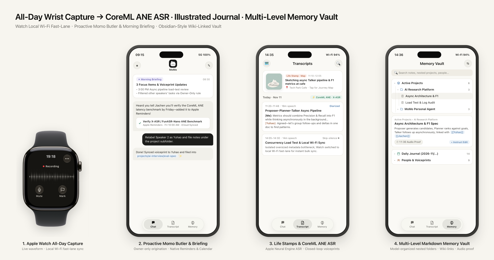
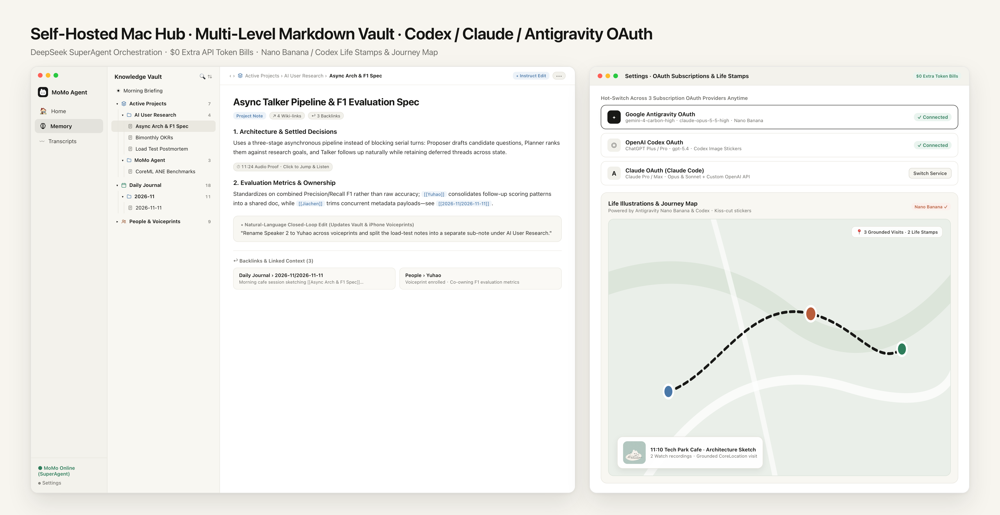
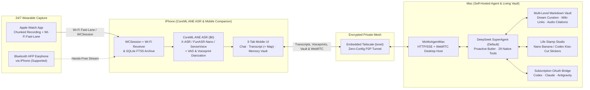

<div align="center">


# MoMo Agent

**Make Life Your Context — An Open-Source, Self-Hosted 24/7 Personal Agent for Apple Watch, iPhone & Mac**

*100% Free CoreML ANE On-Device ASR · Powered by Codex, Claude & Antigravity OAuth · Obsidian-Style Living Memory Vault*

[](https://github.com/Miri-Labs/MoMo-Agent/releases)
[](LICENSE)
[](https://github.com/Miri-Labs/MoMo-Agent)
[-2E8540?style=flat-square)](#why-momo-agent)
[](#why-momo-agent)
[](#why-momo-agent)

English | [简体中文](./README.zh-CN.md)

</div>

---

**MoMo Agent** is an open-source, fully self-hosted **all-day personal agent** built natively for **Apple Watch, iPhone, and Mac**.

It captures your day effortlessly from your wrist on **Apple Watch** (with automatic **Local Wi-Fi Fast-Lane** bulk transfer) or through a **Bluetooth earphone** connected to your iPhone, transcribes and diarizes speech **100% locally on Apple Neural Engine (`CoreML ANE`) at $0 cost**, and syncs over an **embedded Tailscale encrypted mesh** to your **Mac**—where your proactive butler **Momo** curates an **Obsidian-style multi-level Markdown Memory Vault**, sketches **kiss-cut daily life illustrations**, and manages your Reminders, Calendar, Notes, and desktop tasks using your existing **OpenAI Codex**, **Claude**, or **Google Antigravity** subscription.

<p align="center">
  
  <br />
  <sub>Your devices, working together. Models shown are illustrative. <a href="docs/design/devices/README.md">Model credits &amp; noncommercial artwork license</a></sub>
</p>

### Why MoMo Agent?

- **100% Self-Hosted & Local-First Privacy**: Zero third-party cloud relays. Your raw audio, transcripts, voiceprints, SQLite FTS5 archive, and plain-Markdown memory vault stay exclusively on your own Apple Watch, iPhone, and Mac.
- **$0 On-Device CoreML ANE Speech Suite**: Choose between **X-ASR CoreML ANE**, **FunASR-Nano CoreML ANE**, and **SenseVoice** (with built-in on-device ANE latency benchmarking), paired with dual-stage VAD (`libfvad` + `Silero`) and speaker diarization.
- **$0 Extra AI Token Bills (3 Subscription OAuth Providers)**: Running a 24/7 life-context agent shouldn't rack up runaway API bills. MoMo Agent natively drives your signed-in **OpenAI Codex** (`ChatGPT Plus / Pro`), **Claude** (`Claude Pro / Max` via Claude Code), or **Google Antigravity** (`Gemini 4` / `Claude 5.5` via `agy` CLI) subscription—plus custom OpenAI-compatible APIs—and lets you hot-switch providers anytime in Settings.
- **Obsidian-Style Multi-Level Living Memory Vault**:
  - **Model-Organized Nested Hierarchy**: Autonomous background **"Dream"** curation freely organizes knowledge into multi-level directories (`projects/ai-interview/eval-spec.md`, `journal/2026-11/2026-11-11.md`, `people/...`, `topics/...`, `BRIEFING.md`, and custom folders)—just like a well-gardened Obsidian vault.
  - **Wiki-Links, Backlinks & Audio Proof**: Every note weaves `[[wiki-links]]`, computes automatic **Backlinks**, and embeds clickable `[⏱ HH:MM Audio]` citations that jump straight back to the original voice recording.
  - **Closed-Loop Natural-Language Editing (`Instruct Edit`)**: Tell Momo *"Rename Speaker 2 to Yuhao and split the load-test section into a separate sub-note"*—Momo updates the Markdown vault **and** pushes the speaker voiceprint correction back to your iPhone in one loop.
- **Proactive Personal Butler & Daily Morning Briefing**:
  - Powered by **DeepSeek SuperAgent** (`dsh-superagent`) with **29 built-in life & desktop tools** across **Apple Reminders, Apple Calendar, Apple Notes** (iCloud-synced), web research, and `agent-desktop` Mac UI automation.
  - **Owner-Only Origination Rule**: Grounded in your enrolled voiceprint so Momo acts only on *your* commitments and requests—never mistaking another speaker's todo for yours.
- **Daily Life Illustrations (`Nano Banana` & `Codex`) + Journey Map**:
  - Pairs conversation episodes with reliable `CoreLocation` visits (never hallucinating unvisited places) and renders warm **kiss-cut paper stamp illustrations** via **Google Antigravity (`Nano Banana`)** or **OpenAI Codex**, displayed atop your daily Transcripts and pinned onto an interactive `MKMapView` trajectory map.
- **24/7 Wrist & Earphone Capture + Embedded Tailscale**:
  - **Apple Watch + Local Wi-Fi Fast-Lane**: Continuous background recording, live dot-matrix waveform, Mute/Mark controls, `WCSession` streaming, and automatic high-speed local Wi-Fi bulk transfer when Watch and iPhone share a network.
  - **Bluetooth Earphones (Supported)**: Record via compatible HFP Bluetooth microphones on iPhone (verified on Shokz OpenMove and Sony WH-1000XM6; *AirPods validation pending*).
  - **Embedded Tailscale (`tsnet`)**: Encrypted peer-to-peer connectivity between iPhone and Mac from anywhere—no public IP or port forwarding required.

---

### Product Preview

#### 1. Wrist Capture, Proactive Butler, Illustrated Journal & Mobile Vault (`watchOS` + `iOS`)

<p align="center">
  
</p>

- **1. Apple Watch All-Day Capture**: Continuous wrist recording with live dot-matrix waveform, one-tap **Mute** / **Mark**, and automatic **Local Wi-Fi Fast-Lane** bulk sync.
- **2. Proactive Momo Butler & Morning Briefing**: Daily **Morning Briefing** card, voiceprint-verified **Owner-Only** task admission into Apple Reminders & Calendar, and natural-language speaker relabeling.
- **3. Life Stamps & CoreML ANE Transcripts**: Center **Transcript** tab featuring daily **kiss-cut Life Illustration stamps**, interactive **Journey Map**, **CoreML ANE** offline transcription, and skip-silence playback.
- **4. Obsidian-Style Multi-Level Memory Vault**: Dedicated **Memory** tab (`brain` icon) with collapsible nested project/journal folders, `[[wiki-links]]`, clickable `[⏱ Audio Proof]` chips, and one-sentence **Instruct Edit**.

#### 2. Self-Hosted Mac Hub, Multi-Level Vault & 3-Provider OAuth (`macOS`)

<p align="center">
  
</p>

- **Left (3-Column Knowledge Vault & Reader)**: Browse multi-level nested folders (`Active Projects › AI User Research › ...`), inspect bidirectional `[[wiki-links]]` and **Backlinks**, jump to original audio timestamps, or issue closed-loop natural-language edits.
- **Right (3 Subscription OAuth Providers + Nano Banana & Journey Map)**: Hot-switch seamlessly between **Google Antigravity**, **OpenAI Codex**, and **Claude** OAuth subscriptions at **$0 extra API token cost**, while generating kiss-cut daily life stamps with **Nano Banana** or **Codex** pinned to grounded `CoreLocation` visits.

---

### System Architecture



| Layer | Component | Key Capabilities | Cost |
| :--- | :--- | :--- | :--- |
| **Capture** | `MoMoAgentWatch` (`watchOS 10+`) | 24/7 chunked recording, live waveform, mute/bookmark, **Local Wi-Fi Fast-Lane** + `WCSession` sync; iPhone Bluetooth HFP capture | **$0** |
| **CoreML ANE ASR** | `MoMoSpeech` (`iOS 17+` / `macOS 15+`) | Offline **X-ASR CoreML ANE**, **FunASR-Nano CoreML ANE**, and **SenseVoice**; `libfvad` + `Silero` VAD; voiceprint enrollment & relabeling | **$0** |
| **Archive & Map** | `MoMoArchive` (`SQLite + FTS5`) | Crash-safe event store, millisecond full-text search, silence-skipping playback, grounded `CoreLocation` visit & trajectory map | **$0** |
| **Private Mesh** | `EmbeddedTailnet` (`TailscaleKit`) | User-space WireGuard / Tailscale mesh inside the app; QR pairing with 6-digit verification | **$0** (Tailscale Free Plan) |
| **Living Vault** | `momo_memory` + `memory_review` | Autonomous **Dream** gardening, arbitrary multi-level folders, `[[wiki-links]]` + backlinks, `[⏱ Audio]` proof, Morning Briefing, closed-loop voiceprint & note editing | **$0** (Plain Markdown on disk) |
| **Agent & Art** | `MoMoAgentMac` + `Vendor/SuperAgent` | Proactive **Momo** butler (Owner-Only rule), Apple Reminders / Calendar / Notes tools, WebRTC remote desktop, **Nano Banana** / **Codex** kiss-cut life stamps | **Included in your Codex / Claude / Antigravity subscription** |

---

### Quick Start (Self-Hosting Guide)

For complete step-by-step device provisioning, signing, CoreML model setup, and troubleshooting instructions, see [**`install.md`**](./install.md).

#### Prerequisites
1. **Hardware**: A Mac (`macOS 15.0+`, Apple Silicon recommended), an iPhone (`iOS 17.0+`), and an Apple Watch (`watchOS 10.0+`).
2. **Xcode**: Xcode 16+ with `xcodegen` installed (`brew install xcodegen`).
3. **AI Subscription (Pick Any One or More)**:
   - **OpenAI Codex** (`codex` CLI signed in with ChatGPT Plus / Pro),
   - **Claude** (`claude` CLI signed in with Claude Pro / Max), or
   - **Google Antigravity** (`agy` CLI signed in with Google OAuth — also unlocks **Nano Banana** life illustrations),
   - *or* any custom OpenAI-compatible API endpoint.
4. **Tailscale** *(Optional for cross-network access)*: A free [Tailscale](https://tailscale.com) account for encrypted access outside home Wi-Fi.

#### Step 1: Clone & Configure Signing

```bash
git clone https://github.com/Miri-Labs/MoMo-Agent.git
cd MoMo-Agent
cp Config/Local.xcconfig.example Config/Local.xcconfig
```

Edit `Config/Local.xcconfig` with your Apple Developer Team ID and bundle identifier prefix:

```xcconfig
MOMO_DEVELOPMENT_TEAM = YOUR_TEAM_ID
MOMO_BUNDLE_ID_PREFIX = com.yourname.momoagent
```

#### Step 2: Generate Project & Build Mac Agent (`MoMoAgentMac`)

```bash
xcodegen generate
xcodebuild -project MoMoAgent.xcodeproj -scheme MoMoAgentMac -configuration Release build
```

Launch `MoMoAgentMac` on your Mac and follow the guided onboarding:
1. Choose **Codex**, **Claude**, **Antigravity**, or **Custom API** and sign in (you can hot-switch providers anytime later under **Settings → Model**).
2. Enable **Tailscale** (or Same-Wi-Fi LAN mode) to display the **Pairing QR Code**.

#### Step 3: Build & Install iPhone + Apple Watch Apps (`MoMoAgent`)

Open `MoMoAgent.xcodeproj` in Xcode, select the **`MoMoAgent`** scheme targeting your connected iPhone (which automatically embeds and installs **`MoMoAgentWatch`** onto your paired Apple Watch), and press **Run (`⌘R`)**.

> Need detailed instructions on Developer Mode, CoreML ANE model placement, or device recovery? Check out [**`install.md`**](./install.md).

---

### Repository Structure

```text
MoMo-Agent/
├── Apps/
│   ├── WatchApp/          # watchOS 10+ continuous recorder & Local Wi-Fi Fast-Lane sender
│   ├── iPhoneApp/         # iOS 17+ CoreML ANE ASR, 3-tab UI (Chat · Transcript · Memory) & Journey Map
│   ├── MacApp/            # macOS 15+ self-hosted agent hub, OAuth bridges, Living Vault & Life Stamps
│   └── ClientUI/          # Shared SwiftUI design system, Markdown Vault tree, Tailnet & RTC views
├── Packages/
│   └── MoMoAgentKit/      # Core Swift package (MoMoCapture, MoMoSpeech, MoMoArchive, MoMoAgentClient, MoMoAgentRTC)
├── Vendor/
│   ├── SuperAgent/        # Default proactive runtime (DeepSeek SuperAgent + 29 MoMo PIM/Vault tools)
│   ├── HermesAgent/       # Switchable agent runtime
│   ├── SherpaOnnx/        # On-device ASR & speaker diarization runtime
│   └── TailscaleKit/      # Embedded user-space Tailscale (tsnet) XCFramework
├── Config/                # Signing & version configuration (v0.5.3)
└── project.yml            # XcodeGen project specification
```

---

### Roadmap

- [x] **v0.0.1 — Foundation**: Apple Watch 24/7 capture, offline SenseVoice + speaker diarization, embedded Tailscale mesh, Mac self-hosted agent, and WebRTC remote desktop.
- [x] **Bluetooth Earphone Capture & Watch Wi-Fi Fast-Lane**: HFP Bluetooth recording on iPhone (Shokz OpenMove, Sony WH-1000XM6) + high-speed local Wi-Fi bulk transfer from Apple Watch.
- [x] **CoreML ANE On-Device ASR Suite & Voiceprint Loop**: Added **X-ASR CoreML ANE** & **FunASR-Nano CoreML ANE** with on-device speed benchmarks and conversational speaker relabeling.
- [x] **Proactive Butler, Morning Briefing & Apple PIM Integration**: DeepSeek SuperAgent runtime with Owner-Only origination rule and native **Apple Reminders, Calendar & Notes** tools.
- [x] **Obsidian-Style Multi-Level Memory Vault (`v0.5.x`)**: Model-organized arbitrary-depth folders, `[[wiki-links]]` + backlinks, `[⏱ Audio]` citations, and closed-loop natural-language note/voiceprint editing.
- [x] **Google Antigravity OAuth + Daily Life Illustrations & Journey Map (`v0.5.3`)**: 3-way subscription OAuth (**Codex · Claude · Antigravity**) with hot-switching, plus kiss-cut daily life stamps powered by **Nano Banana** & **Codex** on a grounded `CoreLocation` map.
- [ ] **AirPods Seamless Route Validation**: Verify recording and automatic HFP/A2DP route switching on AirPods.
- [ ] **Open Skill & Vault Sync Ecosystem**: Direct two-way folder sync with external Obsidian vaults, Things 3, and local Git repositories.

---

### Acknowledgments & Open-Source Credits

MoMo Agent stands on the shoulders of extraordinary open-source projects:
- [DeepSeek SuperAgent](https://github.com/deepseek-ai/dsh-superagent-prototype) (`dsh-superagent-prototype`) for proactive ticket admission, worker orchestration, and harness runtime.
- [Sherpa-ONNX](https://github.com/k2-fsa/sherpa-onnx), [SenseVoice](https://github.com/FunAudioLLM/SenseVoice), **X-ASR**, and **FunASR-Nano** for blazing-fast on-device CoreML ANE & offline speech recognition.
- [Silero VAD](https://github.com/snakers4/silero-vad) & [libfvad](https://github.com/dpirch/libfvad) for low-power voice activity detection.
- [Tailscale](https://github.com/tailscale/tailscale) (`tsnet`) for zero-config encrypted peer-to-peer networking.
- [Hermes Agent](https://github.com/NousResearch) for switchable agent orchestration.

---

### License

MoMo Agent's original application source is licensed under **[AGPL-3.0-only](LICENSE)**. Commercial use is permitted under its terms, including the applicable source-sharing requirements. Third-party components and model weights retain their own licenses; the README device illustrations have separate noncommercial restrictions. See [licensing and credits](NOTICE.md).
