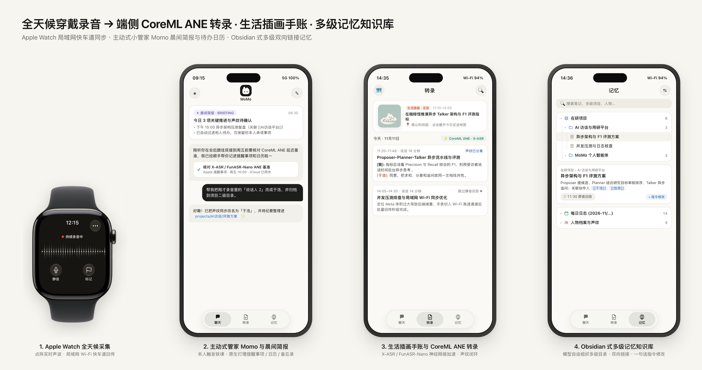
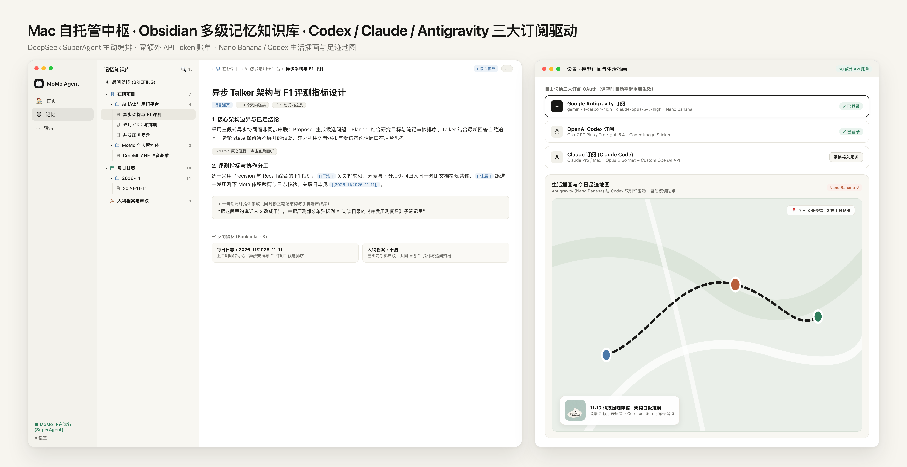
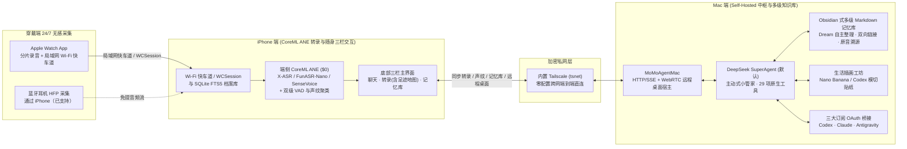

<div align="center">


# MoMo Agent

**让生活成为你的上下文 —— 全天候 Apple Watch 无感录音 · 完全自托管（Self-Hosted）的开源个人智能体**

*端侧 CoreML ANE 语音转录永久免费 · 支持 Codex / Claude / Antigravity 三大订阅驱动 · Obsidian 式多级双向链接记忆库*

[](https://github.com/Miri-Labs/MoMo-Agent/releases)
[](LICENSE)
[](https://github.com/Miri-Labs/MoMo-Agent)
[-2E8540?style=flat-square)](#核心亮点与全新进化)
[](#核心亮点与全新进化)
[](#核心亮点与全新进化)

[English](./README.md) | 简体中文

</div>

---

**MoMo Agent** 是一个专为 **Apple Watch + iPhone + Mac** 原生打造的开源、完全自托管（Self-Hosted）**全天候个人智能体（Personal Agent）**。

它通过手腕上的 **Apple Watch**（支持**局域网 Wi-Fi 快车道**秒级批量回传）或连接 iPhone 的 **蓝牙耳机** 进行全天候无感采集，利用 Apple 神经网络引擎（**CoreML ANE**）在本地**永久免费完成高精度语音转录与说话人声纹分离**，并通过应用内置的 **Tailscale 加密私网** 实时同步到你的 **Mac**。在 Mac 上，贴心管家 **Momo** 直接复用你已有的 **OpenAI Codex**、**Claude** 或 **Google Antigravity** 订阅，为你自主维护一套 **Obsidian 式多级双向链接 Markdown 记忆知识库**、生成**每日模切手账插画与足迹地图**，并打理提醒事项、日历、备忘录与电脑任务——**零第三方云端隐私泄露，零额外按量 API Token 账单。**

<p align="center">
  
  <br />
  <sub>用你自己的设备，让 MoMo 随身相伴。图中机型仅作示意。<a href="docs/design/devices/README.md">模型署名与非商用许可</a></sub>
</p>

### 核心亮点与全新进化

- **100% Self-Hosted 隐私优先**：不经过任何第三方云端中转。原始录音、声纹库、SQLite FTS5 全文档案以及纯文本 Markdown 记忆知识库，100% 存储在你自己的 Apple Watch、iPhone 与 Mac 本地磁盘上。
- **三大 AI 订阅 OAuth 零额外账单（随时热切换）**：全天候 Agent 最昂贵的往往是持续消耗的 API Token。MoMo 直接复用你本机登录的 **OpenAI Codex**（ChatGPT Plus / Pro）、**Claude**（Claude Pro / Max，通过 Claude Code）或 **Google Antigravity**（Gemini 4 / Claude 5.5，通过 `agy` OAuth）订阅，同时也支持接入任意 OpenAI 兼容 API，并可在 Mac「设置 → 模型」中**随时一键更换服务并平滑重启生效**。
- **Obsidian 式多级双向链接记忆库 + Dream 自主园艺**：
  - **模型自由组织多级目录**：后台 **Dream** 记忆引擎不再受限于死板的单层分类，而是像打理 Obsidian 知识库一样，按复杂度自由建立任意深度的子目录（如 `projects/AI访谈/评测方案.md`、`journal/2026-11/2026-11-11.md`、`people/...`、`topics/...`、`BRIEFING.md` 及自定义主题目录）。
  - **双向链接与原音证据直跳**：笔记内天然织入 `[[双向链接]]` 与自动聚合的 **反向提及（Backlinks）**，关键事实附带可点击的 `[⏱ HH:MM 原音]` 胶囊，一点即跳回当时的原始人声片段。
  - **一句话闭环「指令修改」**：直接对笔记或聊天框说一句 *“把这段里的说话人 2 改成于浩，并把压测部分拆到 AI 访谈目录的子笔记里”* —— Momo 不仅会重整多级笔记，还会**自动把声纹改名闭环同步回 iPhone 端声纹库**。
- **主动式私人小管家 Momo 与「晨间简报」**：
  - 默认搭载 **DeepSeek SuperAgent**（`dsh-superagent`）主动编排引擎与 **29 项原生工具**，直接读写 **Apple 提醒事项、日历、备忘录**（通过 iCloud 自动同步至全设备），执行网页调研或接管 Mac 桌面（`agent-desktop`）。
  - **本人触发铁律（Owner-Only Origination）**：严格结合你的个人声纹与话语归属，只为你本人亲口承诺或交代的事项建待办、设提醒，绝不把会议中同事或他人的任务误记到你头上。
- **每日生活插画手账（`Nano Banana` / `Codex`）与足迹地图**：
  - 将当天的真实对话片段与 iPhone `CoreLocation` 可靠停留点对齐（严格杜绝未到访地点幻觉），通过 **Google Antigravity（Nano Banana）** 或 **OpenAI Codex** 自动绘制温暖的**模切白边手账贴纸（Kiss-Cut Stickers）**，呈现在「转录」页顶部的今日手账抬头与原生 `MKMapView` **今日足迹地图**上。
- **100% CoreML ANE 端侧语音引擎矩阵 + 手表局域网快车道**：
  - **三大端侧 ASR 模型自由切换**：在 SenseVoice 之外全新内置 **X-ASR CoreML ANE** 与 **FunASR-Nano CoreML ANE**（含端侧神经网络延迟基准测试），配合 `libfvad` + `Silero` 双级 VAD 与声纹分离，转录成本恒为 **$0**。
  - **全天候穿戴采集与高速同步**：Apple Watch 支持点阵实时声波、静音/标记，除了后台 `WCSession` 续传外，同网下自动开启**局域网 Wi-Fi 快车道**秒级回传大段录音；无手表时亦支持 iPhone 连接 HFP **蓝牙耳机录音**（已实测 Shokz OpenMove、Sony WH-1000XM6，AirPods 待验证）。

---

### 界面与功能预览

#### 1. 手腕无感采集 · 主动式管家晨间简报 · 生活插画手账 · 随身多级记忆库（`watchOS` + `iOS`）

<p align="center">
  
</p>

- **1. Apple Watch 全天候采集**：抬腕即录、点阵声波反馈、一键**静音**与重点**标记**，支持局域网 Wi-Fi 快车道高速回传。
- **2. 主动式管家 Momo 与晨间简报**：每天清晨生成 **晨间简报（BRIEFING）**；遵循「本人触发铁律」自动帮你把口头承诺记入 Apple 提醒事项与日历，一句话修正说话人声纹。
- **3. 生活插画手账与 CoreML ANE 转录**：居中主入口「转录」栏，顶部展示今日**模切手账插画与足迹地图**，下方呈现 **CoreML ANE** 极速离线转写、说话人分离与跳过静音连续回放。
- **4. Obsidian 式多级记忆知识库**：独立底部「记忆」主入口（大脑图标），支持多级目录折叠展开、`[[双向链接]]`、点击直跳 `[⏱ 原音回放]` 与一句话**指令修改**。

#### 2. Mac 自托管中枢 · 多级 Markdown 记忆阅读器 · 三大订阅热切换与 Nano Banana 插画（`macOS`）

<p align="center">
  
</p>

- **左（三栏式多级记忆知识库与阅读器）**：支持多级目录树（`在研项目 › AI 访谈与用研平台 › ...`）与面包屑导航、双向链接与**反向提及（Backlinks）**聚合、原音证据溯源回听，以及同时更新笔记与手机声纹的闭环指令修改。
- **右（三大 OAuth 订阅热切换 + 生活插画与足迹地图）**：在 **Google Antigravity**、**OpenAI Codex** 与 **Claude** 三大订阅间自由切换（`$0` 额外 Token 账单），并由 **Antigravity (Nano Banana)** 与 **Codex** 双引擎驱动模切手账贴纸与停留点足迹地图。

---

### 系统架构



| 模块 | 对应组件 | 核心能力 | 运行成本 |
| :--- | :--- | :--- | :--- |
| **穿戴采集** | `MoMoAgentWatch` (`watchOS 10+`) | 全天候后台分片录音、点阵声波、静音/标记、**局域网 Wi-Fi 快车道** + `WCSession` 双通道回传；支持 iPhone 蓝牙耳机录音 | **免费 ($0)** |
| **CoreML 转录** | `MoMoSpeech` (`iOS 17+` / `macOS 15+`) | 端侧离线 **X-ASR CoreML ANE**、**FunASR-Nano CoreML ANE** 与 **SenseVoice**；`libfvad` + `Silero` VAD；声纹注册与对话式改名 | **免费 ($0)** |
| **归档与足迹** | `MoMoArchive` (`SQLite + FTS5`) | 崩溃安全事件存储、毫秒级全文检索、跳过静音连续回放、基于 `CoreLocation` 真实停留点的今日足迹地图 | **免费 ($0)** |
| **私网互联** | `EmbeddedTailnet` (`TailscaleKit`) | 应用内嵌用户态 Tailscale 节点；扫码配对 + 6 位数字核验，外网蜂窝网络直连家中 Mac | **免费**（Tailscale 个人免费版） |
| **多级记忆库** | `momo_memory` + `memory_review` | **Dream** 后台自主园艺、模型自由创建多级目录、`[[双向链接]]` 与反向提及、`[⏱ 原音]` 引用、晨间简报、一句话闭环改笔记与声纹 | **免费 ($0)**（本地纯 Markdown） |
| **管家与插画** | `MoMoAgentMac` + `Vendor/SuperAgent` | 主动式小管家 **Momo**（本人触发铁律）、原生打通提醒事项/日历/备忘录、WebRTC 远程接管桌面、**Nano Banana** / **Codex** 生活插画 | **复用已有 Codex / Claude / Antigravity 订阅** |

---

### 快速开始（Self-Host 部署指南）

如需查看完整的真机签名配置、CoreML 模型导入、首次启动引导与故障排查说明，请直接参考 [**`install.md`**](./install.md)。

#### 环境要求
1. **硬件设备**：一台 Mac（`macOS 15.0+`，推荐 Apple Silicon）、一部 iPhone（`iOS 17.0+`）以及一块配对的 Apple Watch（`watchOS 10.0+`）。
2. **开发环境**：Xcode 16+，并安装 `xcodegen`（`brew install xcodegen`）。
3. **AI 订阅账号（任选其一或多者并存）**：
   - **OpenAI Codex**（`codex` CLI，使用 ChatGPT Plus / Pro 订阅登录），
   - **Claude**（`claude` CLI，使用 Claude Pro / Max 订阅登录），
   - **Google Antigravity**（`agy` CLI，使用 Google OAuth 登录 —— 同时自动解锁 **Nano Banana** 每日生活插画生成），
   - *或* 任意自定义 OpenAI 兼容 API Key。
4. **Tailscale 账号** *(跨网直连推荐)*：注册免费的 [Tailscale](https://tailscale.com) 账号，用于在外网安全直连家中的 Mac。

#### 第一步：克隆仓库与配置签名

```bash
git clone https://github.com/Miri-Labs/MoMo-Agent.git
cd MoMo-Agent
cp Config/Local.xcconfig.example Config/Local.xcconfig
```

编辑 `Config/Local.xcconfig`，填入你的 Apple 开发者 Team ID 与自定义 Bundle ID 前缀：

```xcconfig
MOMO_DEVELOPMENT_TEAM = 你的_TEAM_ID
MOMO_BUNDLE_ID_PREFIX = com.yourname.momoagent
```

#### 第二步：生成工程并启动 Mac 端 (`MoMoAgentMac`)

```bash
xcodegen generate
xcodebuild -project MoMoAgent.xcodeproj -scheme MoMoAgentMac -configuration Release build
```

在 Mac 上运行 `MoMoAgentMac`，按照引导完成初始化：
1. 选择 **Codex**、**Claude**、**Antigravity** 或 **自定义 API** 完成登录（后续可随时在「设置 → 模型」中点击 **更换接入服务** 热切换）；
2. 开启 **Tailscale 私网**（或同一局域网模式），生成 **Mac 配对二维码**；
3. 按需开启提醒事项/日历/备忘录及屏幕录制权限，解锁完整小管家与远程桌面能力。

#### 第三步：编译安装 iPhone 与 Apple Watch 端 (`MoMoAgent`)

使用 Xcode 打开 `MoMoAgent.xcodeproj`，选择 **`MoMoAgent`** Scheme，目标设备选择你的 iPhone（Xcode 会自动将内嵌的 **`MoMoAgentWatch`** 安装到配对的 Apple Watch 上），按下 **`⌘R`** 运行：
1. 打开 iPhone 上的 **MoMo**，扫描 Mac 屏幕上的配对二维码完成绑定；
2. 在手机设置中录入你的**个人声纹**（激活「本人触发铁律」）；
3. 打开 Apple Watch 上的 **MoMo** 开始录音，让生活自然沉淀为你的个人记忆库。

> 关于详细的真机安装步骤、开发者模式启用与常见问题排查，请参阅 [**`install.md`**](./install.md)。

---

### 开源路线图 (Roadmap)

- [x] **v0.0.1 初始开源版本**：Apple Watch 全天候分片录音、iPhone 离线 SenseVoice 转录与声纹分离、内置 Tailscale 私网穿透、Mac 自托管 Agent 与 WebRTC 远程桌面。
- [x] **蓝牙耳机采集与手表 Wi-Fi 快车道**：支持 iPhone 通过蓝牙耳机持续录音（已实测 Shokz OpenMove、Sony WH-1000XM6），并新增 Apple Watch 局域网 Wi-Fi 高速批量回传通道。
- [x] **CoreML ANE 端侧语音矩阵与声纹闭环**：新增 **X-ASR CoreML ANE** 与 **FunASR-Nano CoreML ANE** 神经网络加速引擎（含端侧测速基准），支持对话式修正说话人声纹。
- [x] **主动式小管家 Momo、晨间简报与 Apple 原生生态打通**：集成 DeepSeek SuperAgent 主动编排引擎、本人触发铁律，原生读写 Apple 提醒事项、日历与备忘录。
- [x] **Obsidian 式多级 Markdown 记忆知识库 (`v0.5.x`)**：Dream 自主园艺、模型自由创建多级目录、`[[双向链接]]` 与反向提及、`[⏱ 原音]` 证据跳转，以及一句话闭环指令修改。
- [x] **Google Antigravity OAuth + 每日生活插画与足迹地图 (`v0.5.3`)**：打通 **Codex · Claude · Antigravity** 三大订阅随时热切换，并支持由 **Nano Banana** 与 **Codex** 驱动的模切手账插画与真实停留点足迹地图。
- [ ] **AirPods 路由无缝切换验证**：完善 AirPods 佩戴下的通话/媒体音频路由平滑切换验证。
- [ ] **外部知识库与技能生态双向同步**：支持与本地外部 Obsidian 仓库、Things 3 及本地 Git 仓库双向联动。

---

### 致谢与开源鸣谢

MoMo Agent 站在众多优秀开源项目的肩膀之上：
- [DeepSeek SuperAgent](https://github.com/deepseek-ai/dsh-superagent-prototype)（`dsh-superagent-prototype`）：提供主动式工单准入、子智能体编排与运行时底座。
- [Sherpa-ONNX](https://github.com/k2-fsa/sherpa-onnx)、[SenseVoice](https://github.com/FunAudioLLM/SenseVoice)、**X-ASR** 与 **FunASR-Nano**：提供极速离线与 CoreML ANE 端侧语音识别及声纹聚类能力。
- [Silero VAD](https://github.com/snakers4/silero-vad) 与 [libfvad](https://github.com/dpirch/libfvad)：提供低功耗双级语音活动检测。
- [Tailscale](https://github.com/tailscale/tailscale)（`tsnet`）：提供零配置端到端加密私网互联。
- [Hermes Agent](https://github.com/NousResearch)：提供可切换的智能体编排引擎。

---

### 开源许可证

MoMo Agent 原创应用源码采用 **[AGPL-3.0-only](LICENSE)**。允许遵守许可证条款的商业使用，并需履行适用的源码开放义务。第三方组件与模型权重保留各自许可证；README 设备配图另有非商业使用限制。详见[许可证与第三方声明](NOTICE.md)。
